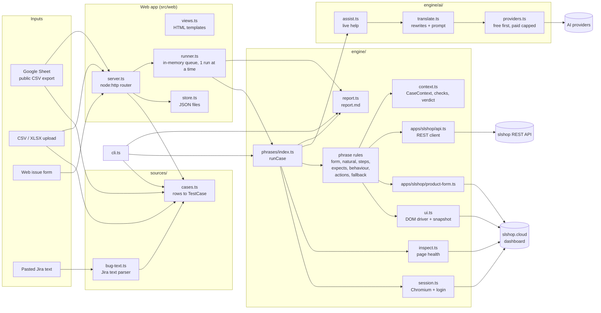

# SL QA: how it works (technical)

This guide is for engineers joining the project. It explains what SL QA does, what it is built with, and how one test case moves from a sheet row to a verdict in a report. File references are to the repo root, `/Volumes/mySSD/projects/bug-triage-bot`. Line numbers are approximate and will drift as the code changes.

**Related docs:** [Plain-English overview](how-it-works-overview.md)

> Secrets: this document lists `.env` variable **names** only. Never paste values from `.env`, `.auth/` or `data/` into docs, issues or AI prompts.

---

## 1. Purpose

SL QA reads QA test cases and bug reports written in plain English and runs them against the **slshop.cloud merchant dashboard**: a real store, logged in as the owner. It then writes a report saying what passed, what failed and why.

Ways to give it cases:

- a public Google Sheet link
- an uploaded CSV or XLSX file
- an issue typed into the web form
- a Jira bug pasted as text, which is parsed into fields for a person to check

There are two front ends over one engine:

- a **web app** (`src/web/`, default port 4100)
- a **CLI** (`src/cli.ts`)

The engine is mostly rule-based (the "phrase engine"). An optional **AI layer** helps when the rules cannot read a sentence or a step fails. **The AI never decides a verdict.** Verdicts come only from recorded checks.

---

## 2. Tech stack

### What is used

| Layer | Technology | Version (lockfile) | Notes |
|---|---|---|---|
| Language | TypeScript, ESM (`"type": "module"`) | typescript 7.0.2 | `strict`, target ES2022, `moduleResolution: Bundler`, `noEmit` (`tsconfig.json`) |
| Runtime | Node.js, run through **tsx** | tsx 4.23.15 | No build step; `tsx` runs the `.ts` files directly. Local Node is v22. |
| Browser automation | **Playwright** (Chromium) | playwright 1.64.1 | Listed under devDependencies but used at runtime (so are `tsx`, `csv-parse` and `dotenv`); only `exceljs` and `marked` are in `dependencies` |
| CSV parsing | csv-parse | 7.0.3 | CSV uploads and Google Sheet CSV export |
| XLSX parsing | exceljs | 4.4.0 | First worksheet only |
| Markdown to HTML | marked | 18.1.1 | Renders `report.md` in the web app |
| Config | dotenv | 18.0.8 | Loads `.env` |
| Types | @types/node | 26.6.5 | |
| Web server | Node built-in `node:http` | n/a | Hand-written router and body parser in `src/web/server.ts` |
| Storage | JSON files on disk | n/a | `data/` and `runs/` |
| AI calls | plain `fetch` | n/a | No provider SDKs (`src/engine/ai/providers.ts`) |

### What is NOT used

- **No Python.** There are no `.py` files, `requirements.txt`, `Pipfile` or `pyproject.toml`, and nothing in the repo mentions Python. Everything is TypeScript on Node.
- **No web framework** (no Express, Fastify or Next.js) and **no front-end framework**. Pages are HTML template strings (`src/web/views.ts`).
- **No database** and no database driver.
- **No test runner** such as `@playwright/test`. The project uses the Playwright library directly and has its own runner and verdict logic.
- **No AI SDKs.** Providers are called with `fetch` against their HTTP APIs.

### Scraping or browser automation?

This is **browser automation for end-to-end testing, plus direct REST API calls**. It is not scraping.

- **Playwright** launches Chromium (`src/engine/session.ts:19`) and drives the logged-in dashboard like a person: go to a page, click, type, select.
- The bot **reads the DOM** a lot, but only to check results, never to harvest content:
  - `Ui.snapshot()` (`src/engine/ui.ts:103-205`) runs after every step and collects cards, tabs, table rows, pager text, dialogs, toasts and so on.
  - `inspectPage` (`src/engine/inspect.ts`) records page health before the steps.
- A thin **REST client** (`src/engine/apps/slshop/api.ts`) calls the slshop backend to create test data, verify values and clean up afterwards.
- **A read-only crawler** (`src/engine/apps/slshop/crawl.ts`, §6.6) walks the logged-in dashboard in the same Playwright browser to build a site map of UI labels (no store data). It is not an HTTP scraper.
- **No HTTP page scrapers.** The only other `fetch` calls are:
  - the Google Sheet CSV export (`src/engine/sources/google-sheet.ts`)
  - the AI providers (`src/engine/ai/providers.ts`)
  - the token check (`GET /auth/me`, `session.ts:~79`)

Why this approach: the dashboard is a JavaScript single-page app behind a login, and the things being tested are behaviour (clicks, forms, toasts, totals). Only a real browser exercises that. The API is used where the UI would be slow or ambiguous: setting up data, reading back saved values, and cleaning up.

---

## 3. Architecture



---

## 4. Repository layout

| Path | What it holds |
|---|---|
| `package.json` | Scripts: `start`, `dev`, `cli`, `typecheck`. The description still says "Zero-AI", which is out of date. |
| `.env.example` | Names of all config variables (see §10) |
| `src/cli.ts` | Command-line runner and `--preview` |
| `src/web/server.ts` | HTTP server, routes, body parsing, optional Basic auth, the issue form handler (`issueFromForm`) |
| `src/web/views.ts` | All HTML pages as template strings, with an `esc()` escaper |
| `src/web/runner.ts` | In-memory run queue (one run at a time), cancel, restart recovery |
| `src/web/store.ts` | File-based suites and runs (`data/suites`, `data/runs`) |
| `src/web/example.ts` | The built-in "Example: try SL QA" suite |
| `src/engine/config.ts` | Reads `.env`; fixed paths (`.auth/state.json`, `runs`, `data`) and `fixturePrefix: 'BTB'` |
| `src/engine/session.ts` | Chromium launch, login, storage state reuse, per-case browser contexts |
| `src/engine/context.ts` | `CaseContext`: pages, checks, notes, screenshots, fixtures, cleanup, `verdictFrom` |
| `src/engine/inspect.ts` | Page health inspection before steps |
| `src/engine/ui.ts` | Dashboard driver (buttons, groups, dialogs, bulk bar) and `snapshot()` |
| `src/engine/pages.ts` | `PAGES` map (39 hand-written names) merged with every page in the site map: about 800 names for about 140 paths. `pagePath`, `pageInfo`, `knownPage`, `knownPages`, `PAGE_NAMES` |
| `src/engine/report.ts` | Writes `report.md` |
| `src/engine/sources/` | `cases.ts` (TestCase model, column aliases, `rowUrl`), `google-sheet.ts`, `upload.ts`, `bug-text.ts` |
| `src/engine/phrases/` | The phrase engine (see §6) |
| `src/engine/apps/slshop/api.ts` | REST client for the slshop backend |
| `src/engine/apps/slshop/product-form.ts` | Dedicated driver for the Add/Edit Product form |
| `src/engine/apps/slshop/crawl.ts` | Read-only site crawler (`discoverPages`), site map I/O, and `siteCases` (one read-only QA case per page) |
| `src/engine/apps/slshop/site-map.json` | The generated site map (committed). UI labels only |
| `src/engine/fixtures/images.ts` | Locally generated upload files (PNG/JPEG/WEBP/GIF/PDF, fake `.exe`) |
| `src/engine/ai/` | `providers.ts`, `translate.ts`, `assist.ts` (see §7) |
| `data/` (git-ignored) | Suites, runs, uploads, `translations.json`, `ai-usage.json` |
| `runs/` (git-ignored) | Per-run `shots/`, `downloads/`, `report.md` |
| `.auth/` (git-ignored) | Playwright storage state for the logged-in owner |
| `scratch/` (git-ignored) | Throwaway probes, including the offline understanding probe `scratch/probe/probe.ts` (§13) |

---

## 5. End-to-end workflow

### Step 1. Input

- **Google Sheet** (`sources/google-sheet.ts`): the sheet link becomes a CSV export URL, using the `gid` in the link (default 0). It tries 3 times. An HTML response means the sheet is private; it must be shared as "anyone with the link" (there is no OAuth).
- **Upload** (`sources/upload.ts`): `.csv` or `.xlsx`, first worksheet only, row 1 is the header. The original is kept at `data/uploads/<suiteId>-<name>` so "Sync" can re-read it.
- **Web form** (`issueFromForm`, `server.ts:418-450`): Title and Expected are required, and so is the page link when the suite was created as a hand-typed (manual) suite. Steps are split per line with `1.` / `1)` removed; expected lines with bullets removed.
- **Pasted Jira bug**: goes through `parseBugText` and fills the form back in. Nothing is saved until a person clicks save (`server.ts:236-246`).

### Step 2. Parse into a TestCase

`TestCase` (`sources/cases.ts:3-23`) has: id, scenario, title, type, priority, preconditions, steps[], testData, expected[], automation, url, reported, manual, edited.

- **Column aliases** (`cases.ts:28-35`) are matched case-insensitively. For example, steps can be `Test Steps`, `Steps`, `Steps to Reproduce` or `Repro Steps`. `Test Scenario`, `Type`, `Priority`, `Preconditions`, `Test Data` and `Automation` must match exactly.
- A row whose ID starts with "Scenario N" is a section header and is skipped.
- If a Description cell contains Jira-style sections ("steps to reproduce", "expected result:", "actual result:"), it is parsed with `parseBugText` (`bug-text.ts:33-61`). Filled-in columns still win.
- **Page link** (`rowUrl`, `cases.ts:91-102`): the URL column, or the first `slshop.cloud` link or `/dashboard…` path in the row. If empty, the suite's start page is used (default `/dashboard/products`). For pasted bugs, a "navigate / go / open / visit / switch to X page" step is mapped through `pages.ts` (`bug-text.ts:56-58`).

### Step 3. Queue

- **Web**: `runner.ts` keeps an in-memory queue and runs **exactly one run at a time** for the whole process, because tests change shared store data (`runner.ts:7-48`).
  - Cancel removes a queued run or stops a running one between cases.
  - On restart, runs still `queued` or `running` are marked `failed` (`runner.ts:31-35`).
  - Progress is written to the run JSON at most every 700 ms.
- **CLI**: runs cases one after another in one session. It does not use the web queue, so a CLI run can overlap a web run.

### Step 4. Browser session and login

`startSession` (`session.ts`):

1. Reads `.auth/state.json` (Playwright storageState) and takes `auth_token` and `store_id` from localStorage.
2. Checks the token with `GET /auth/me`.
3. If it is missing or invalid, logs in through the UI (Phone tab, `identifier` and `password` fields from `.env`, "Sign In") and saves the state (`session.ts:53-66`).
4. Each case gets a fresh `browser.newContext`: viewport 1440×900, accepted downloads, clipboard permission, and an init script that resets `store_id` on first load so store switches do not leak between cases (`session.ts:33-48`).

### Step 5. Page inspection

`runCaseInner` (`phrases/index.ts:151-172`):

1. The row's own URL replaces the suite start page.
2. `inspectPage` opens the start page in a fresh tab (90 s cap) and records: final URL, HTTP status, load time, title, headings, buttons, main text, blank page, error-like texts (NaN, undefined, "something went wrong", 404/500), broken images, console errors, failed requests, slow requests (> 3 s) and a screenshot (`inspect.ts`).
3. Fixtures are planned from the wording and created through the API (`planFixtures` / `applyFixtures`, `phrases/fixtures.ts:32-106`). For example "variable product", "N test products", a barcode pair or a stock/threshold pair create products named `BTB <case id> …`. "Ordered before" does **not** create one: it borrows a real product that has past orders and restores and re-activates it afterwards. An "empty category" is handled later by a step rule, which reuses an existing empty category or creates a `BTB` one.
4. If live AI is on, a clause has no rule, and the case wording changes a product (status, price, stock, edit, delete and so on, but not "add product"), `prepareAiProduct` creates a `BTB` test product for the AI to act on (`index.ts:170`, `assist.ts:121-138`).

### Step 6. Steps through the rules

Each step sentence is split into clauses (`split.ts:23-35`) and matched against rule tables (§6). The first match runs. While running, `CaseContext.newPage` logs console errors and failed API requests, captures every toast, and auto-handles `beforeunload` and JS dialogs (`context.ts:116-150`). After each step, `Ui.snapshot()` records the page state.

### Step 7. AI help (optional)

- A sentence the rules cannot read goes to `understandStep` (`index.ts:180-190`).
- A step that throws goes to `recoverStep`, once per clause (`index.ts:229-261`).

Details are in §7.

### Step 8. Expected-result checks

Expected text is split into claims (`split.ts:37-62`) and each claim is matched in this order (`index.ts:37-43`, `276-320`):

1. Upper-case `EXPECT …` lines go straight to the step-language checks.
2. Form checks (form cases only), then `EXPECT_RULES`, then `BEHAVIOUR_RULES`, then step-language checks.
3. An approved AI rewrite.
4. `fallbackCheck` (`fallback.ts:23-56`): login redirect, "no errors / loads normally", "no NaN/undefined", and single-quoted text present or absent.
5. Live `understandExpect`. A failing AI-written check becomes `review`, not `fail`.
6. Otherwise a skip: "Not understood".

A rule that records no check becomes a skip ("Nothing to compare"). If nothing was compared at all, a "Page loads without errors" check from the inspection is added (`index.ts:322-325`).

### Step 9. Verdict

`verdictFrom` (`context.ts:254-260`), first match wins:

| Condition | Verdict |
|---|---|
| any check `fail` | **Fail** |
| any check `review` | **Review** |
| no check `pass` | **Blocked** |
| any check `skip` | **Partial** |
| otherwise | **Pass** |

Two more outcomes:

- A thrown error with no failing check gives **Error** (with a failing check it stays **Fail**).
- A case that runs past `CASE_TIMEOUT_SECONDS` (default 600) gives **Error** (`index.ts:137-147`).
- A hard `Blocked` makes the case **Blocked**, or **Fail** if a check had already failed (`index.ts:327-331`).

### Step 10. Report

`writeReport` (`report.ts:15-74`) writes `runs/<id>/report.md` and copies it to `./report.md`. It contains:

- a header and summary table
- **Findings** for failed cases: expected vs actual, likely cause, health evidence, screenshot
- **To review** (AI checks)
- other problems seen on the pages, and slow requests grouped by endpoint (median and max)
- **Details** per case: page health, steps marked ✓ ✗ ? – (live-AI steps get an "(AI)" label; approved rewrites show "(AI rewrite, approved)" in the step text), checks, notes, failed API requests, console errors, screenshot links
- a **Fix prompt** for each case that has failing checks, for developers

The web app shows it as HTML (rendered with `marked`, with Print / save as PDF), as a `.md` download, and serves the PNG screenshots. The run page compares each case with its previous result.

### Step 11. Cleanup

`cleanup()` runs after every case, including Blocked and Error paths (`index.ts:329,337`; `context.ts:227-235`). It does not run when a case hits `CASE_TIMEOUT_SECONDS`: the timed-out work keeps running in the background and is ignored (`index.ts:344-350`).

1. Runs registered cleanup callbacks in reverse: categories, brands and labels the product form created, duplicate copies, attribute value lists put back, a borrowed real product restored and re-activated, the POS cart emptied, the sort order put back.
2. Searches the API for products whose name starts with this case's prefix (`BTB <case id>`) and bulk-archives them together with the fixtures.
3. Deletes categories it created.
4. Closes the browser contexts.

Products are **archived, not deleted**, because the backend has no hard delete (`api.ts:135`). Orders, customers and coupons created during a test are **not** cleaned up.

---

## 6. The phrase engine (`src/engine/phrases/`)

### 6.1 Splitting

- **Steps** (`split.ts:23-35`): split on commas (optionally followed by "and"/"then"), " and then ", " then ", and " and <verb>" from a list of about 60 action verbs.
  - A leading context phrase ("On a Variable product, …") is joined to the next action.
  - A piece without a verb reuses the previous verb: "Click the 'All' tab, then 'Active'" becomes two clicks (`index.ts:74-79`).
  - "e.g." pieces are dropped.
- **Expected results** (`split.ts:37-62`): split on `;`, commas, " and ", em-dash and sentence breaks. A piece without "should" or "must" is joined to a neighbour.

### 6.2 Rule tables

Counts are approximate.

| File | Rules | Covers |
|---|---|---|
| `form.ts` | ~52 step rules, all `formOnly` | Add/Edit Product form: sections, dropdowns, fields, switches, variations, slug, images, wholesale tiers, specifications, unsaved-changes warning |
| `form-expects.ts` | ~37 | Product form outcomes |
| `natural.ts` | `FIRST` 6, `LAST` 5 | POS cart, checkout with `TEST_CUSTOMER`, discount, place order, receipt, open page by name, sort, plain click, "observe" |
| `steps.ts` | ~60 | Products list (tabs, search, filter, pager, view, bulk, stock, export, delete), login/logout, other user, switch store, offline |
| `expects.ts` | ~80 | Mostly products-list claims from the original sheet |
| `behaviour.ts` | 8 | Loosely worded behaviour claims (input limit, alert, receipt balance, total above zero, labels follow cards) |
| `actions.ts` | 10 actions + 7 checks | The page-independent step language (§6.4) |
| `fallback.ts` | 4 kinds | Page evidence only |
| `fixtures.ts` | ~10 triggers | Test data created from wording |

### 6.3 Order and gating for steps (`resolveClauses`, `index.ts:50-98`)

1. **Product form gate.** `aboutProductForm` is one regex over the steps and URL (`index.ts:46-48`): `'add product'`, add product button, `'save product'`, click `'edit'` on, edit page, "edit a … product", or a `products/new` / edit URL. Form rules run only if it matches.
2. **Exact step language.** A whole sentence in upper-case `GO TO` / `CLICK` / `TYPE` … is taken as written, unless a more specific rule also matches.
3. **Whole sentence against form rules**, before splitting (form cases only).
4. **Each clause, first match wins**: `ALL_STEP_RULES = [...FORM_RULES, ...FIRST, ...STEP_RULES, ...LAST]` (`natural.ts:402`), then `ACTION_RULES`.
5. **Approved AI rewrite**: for the whole sentence, else per clause. Lines no action rule reads are dropped. An empty rewrite becomes a skip with the reviewer's note.
6. **Live AI** (`understandStep`): its lines replace the clauses.
7. **No rule**: the step is logged `unmatched`, a note is added, and the run continues.

When a step fails (`index.ts:209-268`):

1. A fix that already worked earlier in this case for the same text is reused.
2. Otherwise `recoverStep` asks the AI once. If the fix works, the step counts as done, but a `skip` check is added so the case cannot be a plain Pass.
3. Without a fix, a `Missing` error records a failed check "Step … can be done" and stops the case: the expected results are **not** checked (`StepStop`, `index.ts:265-268`).
4. Any other error stops the case with Error. A soft `Blocked` stops the steps but still checks the expected results; a hard one makes the case Blocked.

### 6.4 Step language grammar (`actions.ts`)

Quoted values use **single quotes** only: the pattern is `'([^']*)'` (`actions.ts:22`), so a label containing an apostrophe cannot be written. Keywords are case-insensitive, but the exact-language shortcut in §6.3 step 2 needs upper case.

**Steps**

| Form | Example |
|---|---|
| `GO TO '<path or url>'` | `GO TO '/dashboard/orders'` |
| `[DOUBLE] CLICK '<name>' [IN '<scope>']` | `CLICK 'Edit' IN 'BTB X-1'` |
| `TYPE\|ENTER\|FILL '<text>' INTO\|IN '<field>'` | `TYPE '100' INTO 'Selling Price'` |
| `CLEAR '<field>'` | `CLEAR 'Search'` |
| `SELECT\|CHOOSE\|PICK '<option>' IN\|FROM '<control>'` | `SELECT 'Active' IN 'Status'` |
| `TURN ON\|OFF '<switch>'` | `TURN OFF 'Track stock'` |
| `CHECK\|UNCHECK\|TICK\|UNTICK '<box>'` | `CHECK 'Select all'` |
| `PRESS '<key>'` | `PRESS 'Enter'` |
| `WAIT <n>[s]` | `WAIT 2` (max 30 s) |
| `UPLOAD '<generated file>' TO\|INTO\|IN '<field>'` | preset file kinds only |

**Checks**

| Form | Behaviour |
|---|---|
| `EXPECT [NO] TEXT '<text>'` | Case-insensitive substring of the whole page text and toasts |
| `EXPECT URL '<part>'` | Substring of the URL |
| `EXPECT BUTTON\|CONTROL '<name>' [ENABLED\|DISABLED\|VISIBLE\|HIDDEN]` | Button, link or switch |
| `EXPECT FIELD '<label>' =\|contains\|!= '<value>'` | Field value |
| `EXPECT VALUE '<label>' = >= <= > < != '<value>'` | Finds a leaf element whose text equals the label, takes the next text in the same small group (card, detail row); if the label is a table header, reads that column in the **first** body row only. Numeric compare when both sides have digits |
| `EXPECT COUNT '<text>'` | Case-sensitive search for a fixed string, e.g. `'Showing 1–1 of 1'` |
| `EXPECT [A\|AN] MESSAGE\|TOAST\|ALERT ['<text>']` | Toast or alert |

**How targets are found** (`actions.ts:30-82`): scopes are `main` then `body`; when a dialog is open they are the topmost dialog then `body` (the page behind the dialog is skipped). Each scope tries `getByRole` for several roles (exact name, then "starts with"), then `getByLabel`, then exact `getByText`, filtered to visible elements. `CLICK … IN '<scope>'` first looks inside a dialog, list row/card or section containing that text. `TYPE` tries label, placeholder, textbox/spinbutton/searchbox roles, then an XPath "label text, then the next input", and opens up to 6 collapsed sections before retrying. If nothing matches, a `Missing` error lists the visible buttons (for clicks) or field labels (for typing).

### 6.5 Page-specific drivers

- **Products list**: rich rules in `steps.ts` and `expects.ts`, using `Ui` and API checks.
- **Add/Edit Product form**: `apps/slshop/product-form.ts`. Its inputs have no `<label for>`, so it uses an XPath label match then `following::input`, a `FIELD_ALIASES` map from sheet wording to labels, and opens collapsed sections. Saving watches POST/PUT/PATCH responses on `/catalog/products[/<id>]` and records status, new ID and server validation errors.
- **POS**: add to cart, fill checkout with the fixed `TEST_CUSTOMER` (`natural.ts:16`), discount through the pencil editor, place a **real order** and read it back through the API.
- **Every other page** uses the `pages.ts` map (now including every crawled page), the sidebar, the step language, plain click, and the fallback checks.

### 6.6 Site map, crawler and whole-dashboard QA (`apps/slshop/crawl.ts`)

**Crawler** (`discoverPages(session, opts)`): one logged-in browser context, 3 tabs working a shared breadth-first queue.

1. Opens `/dashboard`, expands every collapsed sidebar group (`aside nav button[aria-expanded=false]`, up to 5 rounds for nested groups such as Reports › Sales) and reads each link with its group chain and section heading ("Analyze", "Stock", "Money").
2. Visits each page (depth 1), then the links found in its own content and its section menu (`nav[aria-label$="sections"]`) to depth 2. Limits: `maxPages` 200, `maxMs` 15 min (the dashboard has about 140 pages at depth 2: 120 in the sidebar, about 20 found inside them). A page found inside another takes the sidebar group of its closest parent path; `?tab=` pages add the tab to their label. Chart contents (`svg`, `canvas`) are skipped.
3. `crawlPath` keeps only same-origin `/dashboard/...` links. It drops record pages (`?id=`, numeric or UUID segments), anything matching logout/delete/archive/cancel/refund/withdraw/recharge/checkout/reset/disconnect, and every query key except `slug`, `stage`, `tab` and `section` (which select a different page, e.g. `/dashboard/reports/view?slug=cash-flow`).
4. Per page it reads `main` but skips the top bar, sidebar, `tbody`, `article`, dialogs, toasts, summary cards, menus and listboxes: h1 and headings, `role=tab` and the Status group tabs, the section menu, buttons, field labels/placeholders, table headers, the search box placeholder, the Filter button, list signals (rows, "Showing x–y of z", pager) and the breadcrumb. The only click is opening the Filter panel to read its section names, then `Escape`. JS dialogs are dismissed.
5. **Redaction** (`redact`): counts are stripped ("Pending 20" → "Pending"); a label is dropped if it is longer than 60 characters, has no letters, or contains `@`, `৳`/`$`, a URL, a 4+ digit run or a phone-like `+`; and it is dropped if it contains a name of this store's owner, store, products, categories, brands, labels or customers (read through the API, never written anywhere).
6. `kind` is a guess: `report` (reports, analytics, overviews, `/dashboard`), `settings`, `form`, `detail`, `list`, `other`. Pages that only redirect to one already recorded are skipped.

The result is written to `src/engine/apps/slshop/site-map.json` (`{generatedAt, tookMs, pages: PageInfo[]}`) and is committed. A full crawl of about 140 pages takes about 5.5 minutes.

**Page names** (`pages.ts`): at load, `PAGES` is merged with every crawled page by sidebar label, "Group › Label", "Group > Label", "Full › Group › Label", "Label under Group", "Label in Group", "Section › Label", breadcrumb and h1. `PAGES` wins on clashes, then sidebar names, then breadcrumbs and headings. `pagePath` accepts `›`, `»` and `>` separators. `PAGE_NAMES` (the alternation used by the "open page by name" rule) is built once at load from all names, longest first, every name regex-escaped; it is a flat alternation, so matching stays linear (2,000 non-matching sentences take under 10 ms). `reloadPages()` refreshes `pagePath`/`pageInfo` after a crawl; `PAGE_NAMES` picks up new names on restart. `pageInfo(pathOrUrl)` returns the crawled `PageInfo` (headings, tabs, buttons, fields, columns, filters) for prompts and pickers.

**Site cases** (`siteCases(map, {limit, ids, kinds})`): one `TestCase` per page, `SITE-001`…, title "<label> page", scenario = sidebar group, url = path. Steps use only the step language and only safe controls:

| Page has | Steps |
|---|---|
| an enabled "Next page" | `CLICK 'Next page'` |
| tabs | `CLICK '<tab>'` for up to 4 (names that look like create/save/delete are skipped) |
| a Filter button | `CLICK 'Filter'`, `PRESS 'Escape'` |
| a search box | `WAIT 1` (after earlier steps, so the list finishes re-fetching), then `TYPE 'test' INTO '<placeholder>'` |

Expected results: "The page should load without errors.", "The page should not show NaN or undefined values." (fallback checks), `EXPECT TEXT '<h1>'` and, with a search box, `EXPECT FIELD '<placeholder>' = 'test'`. Every generated case previews 100% understood. `--limit N` picks N pages spread evenly over the map, not the first N. Live AI help is switched off for these runs (`AI_LIVE=off` for the run's duration in `runner.ts` and the CLI), so a failed step is reported as it is instead of being "repaired" by clicking some other control.

**Front ends.** CLI: `--crawl [--max N]`, `--site [--preview] [--limit N] [SITE-ID …]` (crawls first if there is no map). Web: the Suites page card "Check the whole dashboard" posts to `/site`. It starts a background crawl (`runner.ts startCrawl`, in memory, one at a time) when the map is missing, over 7 days old, or "Re-crawl" was pressed; otherwise it creates or refreshes the suite "Whole dashboard (auto)" (`source.kind = 'site'`, `syncSiteSuite`). Cases edited or added in that suite, and rows deleted there, are kept on refresh. The suite runs through the normal queue. The **Page link** field on Add case offers the crawled paths as a `<datalist>`.

---

## 7. The AI layer (`src/engine/ai/`)

### 7.1 Provider chain (`providers.ts`)

| Tier | Providers (tried in this order) | Default model |
|---|---|---|
| Free | Gemini, Groq, OpenRouter, Mistral | `gemini-3.5-flash-lite`, `openai/gpt-oss-120b`, `google/gemma-4-31b-it:free`, `mistral-small-latest` |
| Paid | Anthropic, OpenAI, Cerebras | `claude-haiku-5-5`, `gpt-4.1-mini`, `gpt-oss-120b` |

- Every free provider is tried before any paid one. Within a provider, every key is tried (one variable can hold several comma-separated keys).
- Anthropic uses its Messages API. All others use an OpenAI-compatible `/chat/completions` call.
- Models can be overridden per provider. OpenRouter is forced back to a `:free` model.
- Requests use `temperature: 0`, `max_tokens: 700`, and JSON mode where supported.
- Timeouts are 20 s (free) and 45 s (paid). Calls to the same free provider are spaced at least 4 s apart, in memory per process.

**Cool-downs** per provider key (`providers.ts:125-133`):

| Failure | Skipped for |
|---|---|
| auth (bad key, or a 400/404 that mentions "model") | 6 h |
| quota | 15 min |
| server error or timeout | 2 min |
| network error | 1 min |
| unreadable answer | 0 |

A success clears the cool-down. `POST /settings/ai/reset` clears all of them.

**Paid cap**: `AI_PAID_DAILY_LIMIT` (default 20) per UTC day. The counter goes up **before** each paid call, so failures count too. Usage and cool-downs live in `data/ai-usage.json`, which is written without a lock.

### 7.2 Translator and prompt (`translate.ts`)

- The `GUIDE` prompt (`translate.ts:77-119`) teaches the step and check language, with rules such as:
  - use only names from the page list
  - new product names start with `BTB `
  - never invent a number
  - before/after comparisons are reported as not possible
- **Sent with each request**: the page (path plus summary during live runs), case title, all steps and expected results, and the sentence to translate. Live runs also send preconditions and test data; the "Suggest" button on the review page does not.
- The answer must be JSON `{lines, note}`. At most 12 lines are kept.
- Rewrites are stored in `data/translations.json`, keyed by kind plus the normalised sentence (`translate.ts:32`). The key does **not** include the page.

### 7.3 Live help during a run (`assist.ts`)

- **On** when at least one key is set and `AI_LIVE` is not off.
- **Budget**: `AI_MAX_CALLS_PER_CASE` (default 12), separately for steps and for expected results, so up to 24 calls per case.
- **Page summary** (`assist.ts:50-90`): text only, from the open dialog or `main`. It includes URL, dialog title, headings, button and link texts, field labels, the first 6 record names, buttons in the first row, label/value pairs, tabs and sidebar links. Items over 60 characters are dropped. There is no screenshot, and no dropdown options, disabled states, field errors or toasts.
- **`understandStep`**: rewrites a whole unread sentence. Lines that match no action are dropped. AI steps are marked `via: 'ai'`. The suggestion is saved as `suggested` for review, unless a person already reviewed that sentence or its lines name this run's test product (`BTB <ID>-<n>`), which would not be reusable (`assist.ts:108-109`).
- **`recoverStep`**: one fix per failing clause. It is never saved, and a working fix adds a skip ("may be a finding").
- **`understandExpect`**: used only after rules and `fallbackCheck` fail. A failing AI check becomes `review`. A passing AI check counts as a normal pass (a known gap).
- **Test-product safety** (`assist.ts:121-147`): if the case changes a product, a `BTB` test product is created and the AI is told to change no other product. This is a **prompt rule only**; the code does not enforce it.

### 7.4 Reviewed rewrites

- `GET /suites/:id/rewrites` lists sentences the rules miss and their rewrites.
- "Suggest" asks the AI about up to 25 sentences in one request, without a page summary (`server.ts:162-189`).
- People can approve, reject, edit lines, or "Approve all".
- Approved rewrites run with **no AI call** at run time and in preview. An approved empty rewrite means "cannot be automated" and gives a skip. Approved checks that fail give a hard **Fail**.

---

## 8. Data and storage

| Location | Content | Notes |
|---|---|---|
| `data/suites/<id>.json` | One suite with its cases | Written via tmp file then rename |
| `data/runs/<id>.json` | One run with results | Every read parses all files (`store.ts:46-51`) |
| `data/uploads/` | Original uploaded CSV/XLSX | Not removed when a suite is deleted |
| `data/translations.json` | AI rewrites and their review status | Plain write, no lock |
| `data/ai-usage.json` | Paid-call counts and cool-downs | Plain write, no lock |
| `runs/<id>/shots/` | Viewport screenshots `<case>-<n>-<label>.png` | |
| `runs/<id>/downloads/` | Browser downloads | |
| `runs/<id>/report.md`, `./report.md` | Reports | |
| `.auth/state.json` | Logged-in owner session | Secret; git-ignored |

IDs are a timestamp plus 4 random base36 characters and are checked against `^[\w-]+$`. All paths are relative to the working directory, so start the app from the repo root.

---

## 9. Security notes

- The web app has **no auth by default**. Setting `APP_PASSWORD` turns on one shared HTTP Basic password (any username). There are no users, CSRF tokens or rate limits (`server.ts:83-92`).
- Anyone who can reach the port can start runs, and runs can place real orders on the live store.
- Report HTML from `marked` is not sanitised (`server.ts:368`).
- Case text and page values are sent unmasked to AI providers, including free tiers.

---

## 10. Configuration (`.env`)

Names only. See `.env.example` for comments.

| Variable | Required | Purpose |
|---|---|---|
| `BASE_URL` | yes | Dashboard origin |
| `API_URL` | yes | slshop REST API base |
| `LOGIN_PHONE` | yes | Owner login |
| `LOGIN_PASSWORD` | yes | Owner login |
| `APP_PASSWORD` | no | Turns on Basic auth for the web app |
| `PORT` | no | Web port (default 4100) |
| `GEMINI_API_KEY`, `GROQ_API_KEY`, `OPENROUTER_API_KEY`, `MISTRAL_API_KEY` | no | Free AI providers (comma-separated keys allowed) |
| `ANTHROPIC_API_KEY`, `OPENAI_API_KEY`, `CEREBRAS_API_KEY` | no | Paid AI providers |
| `AI_PAID_DAILY_LIMIT` | no | Paid calls per UTC day (default 20) |
| `AI_LIVE` | no | `off` disables live help (review flow still works) |
| `AI_MAX_CALLS_PER_CASE` | no | Default 12 (steps and checks each) |
| `GEMINI_MODEL`, `GROQ_MODEL`, `OPENROUTER_MODEL`, `MISTRAL_MODEL`, `ANTHROPIC_MODEL`, `OPENAI_MODEL`, `CEREBRAS_MODEL` | no | Model overrides |
| `CASE_TIMEOUT_SECONDS` | no | Per-case limit (default 600, read in `phrases/index.ts:137`). Not listed in `.env.example` |

`config.ts` throws at startup if any required variable is missing. With no AI keys, the tool runs rules-only.

---

## 11. How to run

```bash
npm install
npx playwright install chromium   # first time only
cp .env.example .env              # then fill in values locally

# Crawl the dashboard (read-only) and check every page
npx tsx src/cli.ts --crawl
npx tsx src/cli.ts --site --limit 10      # or --preview, or SITE-001 SITE-069 …

# Web app (http://localhost:4100 by default)
npm start          # or: npm run dev  (tsx watch)

# CLI (npm run cli -- <args> is the same thing)
npx tsx src/cli.ts <sheet-url | file.csv | file.xlsx> [TC-ID ...] [--page /dashboard/...] [--headed]
npx tsx src/cli.ts --url /dashboard/orders --expect "Page loads without errors"

# Preview: shows which clauses the rules understand, without running a browser
npx tsx src/cli.ts <source> --preview

# Type check
npm run typecheck
```

Notes:

- The source must be the first CLI argument. `--url` can be repeated, and every `--expect` applies to every `--url`.
- `--preview` prints ✓ or ? per clause with the rule name. It uses approved rewrites but never calls the AI.
- **Runs act on the live store.** Avoid running the CLI while a web run is in progress.

---

## 12. How to extend

### Add a rule

1. Choose the table: a step on the products list goes in `steps.ts`, a claim in `expects.ts` or `behaviour.ts`, product form work in `form.ts` / `form-expects.ts`, and POS or general wording in `natural.ts` (`FIRST` or `LAST`).
2. Add an entry with `name`, a `pattern` regex and a `run(t, m)` function that acts through `t.page`, `Ui` or `Api` and records checks on the `CaseContext`.
3. Order matters: the first match wins (`natural.ts:402`). Prefer the `i` flag and avoid broad catch-alls that would block AI help.
4. Throw `Missing` when a control is not found, so recovery and AI can step in.
5. Check with `--preview` on a sample sheet.

### Add a page

1. New dashboard pages are found by re-crawling (`npx tsx src/cli.ts --crawl`, or Re-crawl in the web app). Add a name to `PAGES` in `src/engine/pages.ts` only for a synonym the dashboard does not show.
2. If it is a list page, look at `Ui.goto` (`ui.ts:72-82`, which has a hard-coded list of list-page paths) and the snapshot column names (`ui.ts:120-136`).
3. For setup and cleanup, add endpoints to `apps/slshop/api.ts` and register cleanup through `CaseContext` so test records use the `BTB` prefix.

### Add an AI provider

1. Add an entry to the provider list in `providers.ts:35-75` with its key variable, default model, endpoint and tier (free or paid).
2. OpenAI-compatible APIs reuse the shared `/chat/completions` path (`callOpenAICompatible`, `providers.ts:229-240`).
3. Add the variable names to `.env.example`. Paid providers count toward `AI_PAID_DAILY_LIMIT` automatically.

---

## 13. Known limitations (summary)

A non-technical summary is in [the plain-English overview](how-it-works-overview.md).

- **Understanding.** An offline probe (`scratch/probe/probe.ts`, preview only: no browser, no AI) of 49 hand-written issues across 31 dashboard areas now finds the rules understand 158 of 202 clauses (78%, up from 51% before the October 2026 upgrade); 20 of 49 cases are fully understood. By style: quoted 97%, formal 84%, Jira pastes 68%, sloppy one-liners 53%. Excluding catch-all rules that match without acting gives 77%. The rest goes to live AI help when a key is set.
  - The second plain-click rule (`natural.ts:361-363`, no `i` flag) needs a lower-case verb and a capitalised name, so "Click Save" is not read; "Click the Save button" is read by the first plain-click rule.
  - Most expected-result regexes match one exact sentence.
  - The product-form gate is a single regex.
- **Silent misreads.** `open dashboard page` falls back to the start page for unknown names (`steps.ts:292-305`). Broad catch-alls match sentences without acting. Neither reaches AI.
- **Coverage.** Dedicated support exists for the products list, product form and POS only. Every crawled page can be opened by name and gets a generic read-only site case (§6.6), but its own wording still needs AI or the step language. The site cases check health, heading, tabs, filter panel, search and next page only; they do not check that a search or filter actually narrows the list. Double-quoted names are not read by the step language or the quoted-text fallback (only straight or curly single quotes).
- **Step language.** No variables or before/after comparisons, no arithmetic, no wait-for-condition, no row-scoped checks, and no hover, reload, back, new tab or download contents.
- **Test data.** Only products and catalog items are cleaned up. Products are archived, not deleted. POS places real orders.
- **AI.** Text-only page view; one repair try. Passing AI checks and AI-run steps are not flagged for review. Rewrites are not tied to a page. Safety is a prompt rule only.
- **Operations.** One in-memory queue, JSON storage without locks, no auth by default, unsanitised report HTML, no CI or integrations (Jira, Slack, GitHub).
