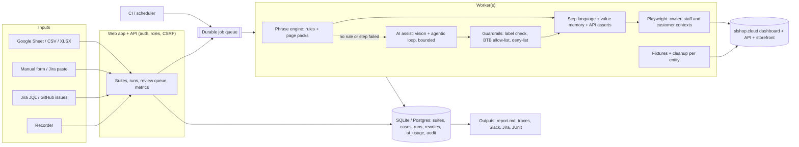

# SL QA: improvement scope and integration guide

**Who this is for:** decision-makers choosing what to fund next, and engineers planning a major upgrade.
**What it's based on:** a read of the code in `src/`, plus an offline probe of 49 hand-written issues across 30 dashboard areas (`scratch/probe/probe.ts`, which calls `previewCase` only). Nothing ran in a browser and no AI was called for this document. Note that `scratch/` is git-ignored, so the probe exists only in the local working copy, not in the repository. File references use the form `file.ts:line`; line numbers are approximate and will drift as the code changes.

**Related docs:** [How SL QA works (technical)](how-it-works-technical.md) · [Plain-English overview](how-it-works-overview.md)

---

## 1. Where things stand today

### 1.1 What the system is

SL QA is a TypeScript app run with `tsx` on Node. It has two front ends:
- a web app on port 4100 (`src/web/`), built on plain `node:http` with no framework
- a CLI (`src/cli.ts`)

Test cases come from four places: a public Google Sheet, an uploaded CSV/XLSX file, a form filled in by hand, or a Jira bug pasted as text. Playwright (Chromium) runs each case against the slshop.cloud merchant dashboard, logged in as the store owner. A small REST client (`src/engine/apps/slshop/api.ts`) creates test data, cleans it up and cross-checks values.

A rule-based **phrase engine** (`src/engine/phrases/`) maps sentences to actions and checks. An **AI layer** (`src/engine/ai/`) steps in only when no rule matches or a step fails. It tries free providers first and falls back to capped paid ones. **The AI never decides a verdict.** Storage is JSON files under `data/` and `runs/`.

### 1.2 Capability snapshot (probe numbers)

| Measure | Result |
|---|---|
| Clauses the rules understood (49 issues, 30 dashboard areas) | **51%** (103/202) |
| Clauses that led to a rule doing real work | **44%** (89/202) |
| Cases fully understood | **14%** (7/49) |
| Quoted step style (`Click 'X'`, `EXPECT TEXT '…'`) | **97%** understood |
| Formal test cases / Jira pastes / sloppy one-liners | 44% / 39% / 29% |
| Effect of adding the `i` flag to the plain-click rule alone | 51% → **60%** |
| Stored cases that used AI help: share that passed | **7%** (2 of 28) |
| `live-` report family: share that passed | 1 of 32 |
| Missed clauses the step language cannot express, even with AI | about 25–30 of 99 |

The probe percentages come from `previewCase` (how sentences are read, not whether runs pass). The last three "stored"/`live-` rows come from local run files under `data/runs/` and `runs/live-*`. The stored data cannot separate real store bugs from misread steps. So the low pass rate in AI-assisted runs is a warning sign, not proof that the AI is wrong.

### 1.3 Coverage by area

| Area | Today |
|---|---|
| Products list; Add/Edit Product form (only when the gate regex matches) | **Well covered**: about 65–83% understood, with API cross-checks |
| POS discount, total and receipt | **Partly covered**: 46%. Places real orders using one fixed `TEST_CUSTOMER` |
| Orders, customers, dues, cashbook, inventory, dashboard home, shipping labels | **Partly covered**: 38–63%. Navigation works; row actions, filters and before/after values do not |
| Coupons, categories, brands, staff, delivery, theme, fraud, barcodes, payments, settings, blog, reports | **Depends on AI**: 0–33% from rules alone. Several of these pages are missing from `pages.ts` |
| Storefront/checkout, second account or staff role, print/new tab, CSV contents, charts, third-party effects | **Not possible**: the step language cannot express them |

### 1.4 The problems that matter most

1. **Silent misreads.** These count as "understood" but do the wrong thing, and they keep the AI from being asked:
   - `open dashboard page` accepts any page name. When the name is not in `PAGES`, it looks for a matching sidebar link, and if there is none it silently opens the suite's start page (`steps.ts:292-305`, `sidebarPath` at `steps.ts:925-933`).
   - "Log in as store owner" (without "the") is not matched by the `log in` rule, so it falls to `log in as other user` and the case is Blocked (`steps.ts:235-247`).
   - Catch-all rules match sentences and do nothing useful: `observe` only takes a screenshot when a dialog is open (`natural.ts:365-372`), and `look/check/compare` does nothing (`steps.ts:365-369`).
2. **False passes.**
   - A live AI-written check that passes counts as a normal pass; only a failing one is turned into Review (`index.ts:297-304`).
   - Steps the AI ran live are labelled *(AI)* in the report, but this does not change the verdict. (A step the AI *repaired* after a failure does add a "not checked" entry, so that case can reach Partial at best: `index.ts:256`.)
   - When nothing could be compared, the page-health fallback adds a "Page loads without errors" check (`index.ts:321-325`). That turns what would be Blocked into Partial (or Pass, if the case had no expected results at all), even though no expected result was verified.
3. **Brittle understanding.**
   - The plain-click rule is case-sensitive (`natural.ts:362`).
   - Many expected-result rules are anchored `^…$` copies of one sheet sentence (`expects.ts`, `form-expects.ts`).
   - One regex gates all the form rules (`index.ts:46-48`).
   - Double quotes are not read: `quoted()` only recognises single quotes (`text.ts:61-74`, used by the fallback at `fallback.ts:14,46`), and the step language's quoted slot is `'([^']*)'` (`actions.ts:22`).
4. **The step language is too small.** It has no variables or before/after values, no row/column scope for checks (only `CLICK 'X' IN 'record'` can scope to a row), no condition waits (only `WAIT <seconds>`), no reload/back/hover/new tab, and no download or network checks. Some of these exist as natural-language rules (for example `reload`), but the AI can only write step-language lines, so it cannot use them.
5. **The AI is weakly grounded and guarded.**
   - It sees only a lossy text summary of the page (`assist.ts:50-90`).
   - It gets one repair try (`index.ts:229`).
   - Test-product safety is a prompt rule only (`assist.ts:146`).
   - Rewrites are keyed by sentence, not by page (`translate.ts:32`).
6. **Live-store hygiene.**
   - Cleanup covers products and catalog data (categories, brands, attributes) plus the POS cart. Products are archived, not deleted, because the app has no hard delete (`api.ts:135-138`).
   - Orders, customers and coupons created in a run stay in the store.
7. **Operations.**
   - Single-process in-memory queue (`runner.ts`).
   - Full JSON directory scans on every listing (`readAll`, `store.ts:46-51`).
   - Auth off by default, with no CSRF protection (`server.ts:83-92`).
   - Unsanitised `marked` output (`server.ts:368`).
   - Unmasked data sent to free AI tiers.
   - No CI, no scheduling, no Jira/Slack connection.

---

## 2. Prioritised roadmap

Effort assumes one engineer who knows the codebase. Risk is the chance of breaking today's rules or the live store.

### 2.1 Quick wins (days, no new dependencies)

| # | Item | Benefit | Effort | Risk | Depends on |
|---|---|---|---|---|---|
| Q1 | Add the `i` flag to the plain-click rule (`natural.ts:362`); let "log in as store owner" match without "the" (the `log in` pattern, `steps.ts:237`) | 51% → about 60% understood; removes a false Blocked | Hours | Low: re-run the probe and the stored products sheet in `--preview` | — |
| Q2 | Make `open dashboard page` throw `Missing` for an unknown page instead of using the start page | No silent wrong navigation; AI and recovery can step in | Hours | Low | — |
| Q3 | Read double quotes in `quoted()` (`text.ts:61`, used by the fallback); let the step language take `"…"` so labels can contain apostrophes (`actions.ts:22`) | Recovers error-message checks; "Don't show" becomes writable | 1 day | Low | — |
| Q4 | Add the missing pages to `pages.ts` (categories, brands, staff, reports, storefront and so on); read "A > B" breadcrumbs in `pagePath` | Navigation works on every dashboard area | 1 day | Low | Q2 |
| Q5 | Widen the product-form gate (`index.ts:46-48`) to "create/new product" and "open the new product page" | Unlocks about 90 form rules and checks for natural wording | Hours | Medium: form rules might start matching list cases; check with the probe | — |
| Q6 | Count passing live AI checks and AI-run steps as **Review**; report AI lines that were dropped (no rule matched, `mapLines` in `assist.ts:92-94`) or cut off (more than 12 lines, `translate.ts:141`) | Ends false passes from AI | 1 day | Low: some Pass results become Review, on purpose | — |
| Q7 | Add the page path to the rewrite key (`translate.ts:32`); remove "Approve all" (`server.ts:196-199`) or require a page summary for offline suggestions (`server.ts:174`) | Fewer wrong rewrites reused on other pages | 1 day | Low: needs a one-time key migration of `translations.json` | — |
| Q8 | Turn auth on by default, sanitise `marked` output, add a CSRF token | Basic safety for a tool that changes the store | 1–2 days | Low | — |
| Q9 | Turn on Playwright tracing, plus video when a case fails | Much faster triage of a Fail | Hours | Low: more disk use | Retention policy (M-ops) |

### 2.2 Medium (1–3 weeks each)

| # | Item | Benefit | Effort | Risk | Depends on |
|---|---|---|---|---|---|
| M1 | **Page-knowledge packs** per area (orders, customers, coupons, categories, staff, settings, POS) | Lifts areas at 0–33% toward the products level; better AI labels | 2–3 days per area | Medium: labels go stale when the UI changes | Q4 |
| M2 | **Value memory and scoped checks** in the step language: `REMEMBER`, comparisons, `IN ROW` for checks, `WAIT FOR`, `RELOAD`, `BACK`, `HOVER`, `TYPE … INTO … IN '<section>'` | Covers stock, total and balance claims, and "appears in the list" checks | 1–2 weeks | Low: additive grammar | — |
| M3 | **Generic fixtures and cleanup** for orders, customers, coupons and categories, plus a **BTB guard in code** | Runs stop leaving data behind; AI cannot touch real records | 1–2 weeks | Medium: needs the right API endpoints per entity | API access per entity |
| M4 | **API-level assertions** (`EXPECT API GET … field = …`) and network checks per step | Precise checks that don't depend on the DOM | 1 week | Low | `Api` class |
| M5 | **Flaky handling**: rerun a failed case once, tag it "flaky" if the rerun passes, keep history per case | Separates bot noise from real bugs | 1 week | Low: longer runs | Run history (B6 helps) |
| M6 | **Jira, GitHub and Slack** (see §4.4) | Closes the loop with the team | 1–2 weeks | Medium: credential handling | Secrets in `.env` only |
| M7 | **CI and scheduling**: headless CLI with exit codes, JUnit output, nightly job | Catches regressions automatically | 3–5 days | Medium: overlaps with web runs | A lock between CLI and web runner |
| M8 | **Multiple accounts and staff roles**: one storageState per account, plus `LOG IN AS 'role'` | Permission issues become testable | 1 week | Medium | Staff test accounts in the store |
| M9 | **More AI repair attempts**: up to N tries, the result fed back, a time budget per case | Recovers from several wrong turns | 1 week | Medium: cost and timeouts | Q6; B1 helps |

### 2.3 Big upgrades (months)

| # | Item | Benefit | Effort | Risk | Depends on |
|---|---|---|---|---|---|
| B1 | **Vision AI**: screenshot plus accessibility tree, and a check that every label exists on the page | Icon buttons, closed menus and visual bugs become reachable | 3–5 weeks | Medium: privacy and cost | Privacy masking, paid budget |
| B2 | **Agentic runner** with a bounded loop and guardrails | Goal-style steps become runnable flows | 1–2 months | High unless M3's guard exists | B1, M2, M3 |
| B3 | **Self-healing locators** | Survives dashboard redesigns | 1 month | Medium: healing might choose the wrong element | M1 |
| B4 | **Recorder**: a manual session becomes step-language lines | Understanding near 100% for recorded issues | 1 month | Low | M2 |
| B5 | **Storefront and checkout session** | Covers storefront prices and checkout coupons | 1 month | Medium: real orders | Customer fixtures (M3) |
| B6 | **Database, multi-user auth, durable queue** | Team use, history, restarts without lost work | 1–2 months | Medium: data migration | — |
| B7 | **Parallel workers** with isolated data | Shorter suite time | 1–2 months | High: runs collide on a shared live store | B6, M3 |
| B8 | **Metrics dashboard** | Shows whether the bot is improving | 2–3 weeks | Low | B6 |
| B9 | **Mobile viewport, downloads, print and new-tab checks** | Covers most of the remaining "not possible" areas | 2–4 weeks | Low | Popup and download handling |

**Suggested order:** do Q1–Q9 first. They are cheap, and they remove false passes and silent misreads. Then do M2, M1, M3 and M4. Start B1 and B2 only after that, so the stronger AI works inside safe, checkable limits.

---

## 3. Design sketches for the biggest upgrades

These are proposals. None of them exists in the code today.

### 3.1 Vision and agentic AI runner (B1 + B2)

- **Input to the AI.** A screenshot of the viewport, an accessibility-tree excerpt of `main` or the open dialog, the page-pack entry for the current path (M1), the case text and the steps so far. This replaces today's text summary in `assist.ts:50-90` (visible headings, buttons, fields and labelled values, each item under 60 characters).
- **Output.** Lines in the **step language only**, parsed by `ACTION_RULES` / `ACTION_EXPECTS`. Free-form Playwright code is never run.
- **Loop.** Plan, act, observe, re-plan, with hard limits:
  - at most N actions per clause and M per case
  - a time budget kept below `CASE_TIMEOUT_SECONDS`
  - the AI-call cap from `AI_MAX_CALLS_PER_CASE` (default 12, counted separately for steps and for expected results: `assist.ts:21-38`)
- **Guardrails in code, not in the prompt:**
  - a label check: every quoted label must appear in the accessibility tree or the page pack, or the line is rejected before it runs
  - a record allow-list: clicks or edits inside a row, dialog or detail page are allowed only when the record name starts with `BTB` or the record was created by this case
  - a deny-list: never press the paid "Write with AI" button, never use logout, delete-store or billing controls, never GO TO another host
  - a stop on any 5xx response or unexpected page navigation
- **Verdicts.** These stay with `verdictFrom` (`context.ts:254-260`). Every AI-run step and AI-written check is recorded as `via: 'ai'`. A case that relied on them can reach **Review** at best, never Pass, until a person approves the lines as a rewrite.
- **Privacy.** Mask phone numbers, emails, customer names and amounts before sending. Send screenshots only to providers whose terms exclude training (paid tiers, or free tiers with training turned off).

### 3.2 Page-knowledge packs (M1)

One file per dashboard area, for example `src/engine/apps/slshop/pages/orders.ts`, holding plain data:

```ts
export const ORDERS = {
  path: '/dashboard/orders', names: ['orders', 'all orders'],
  list: { nameColumn: 'ORDER', columns: ['CUSTOMER', 'TOTAL', 'STATUS'], rowActions: ['View', 'Edit'] },
  filters: ['Status', 'Date'], buttons: ['Create order', 'Export'],
  api: { list: 'GET /sales/orders', detail: 'GET /sales/orders/{id}' },
};
```

Three things would read a pack:
- `pages.ts`, for names and paths
- `Ui.goto` and `snapshot`, for list detection and column names (today hard-coded at `ui.ts:77` and in `snapshot`, `ui.ts:103-136`)
- the AI prompt, for real labels

Generic rules ("click X on the first row", "filter by X", "X should appear in the list") can then work on any page that has a pack.

### 3.3 Value memory in the step language (M2)

Add new lines to `ACTION_RULES` / `ACTION_EXPECTS` in `actions.ts`, storing values in the existing `t.noted` map:

```
REMEMBER VALUE 'Today's Sales' AS sales
REMEMBER API GET /catalog/products/{fixture} FIELD stock AS stock
EXPECT VALUE 'Today's Sales' = sales + 500
EXPECT TEXT 'Delivered' IN ROW 'BTB ORD-1'
WAIT FOR TEXT 'Order placed'      (polls up to 30 s)
RELOAD | BACK | HOVER 'X' | TYPE 'x' INTO 'Note' IN 'Payment'
```

These examples put an apostrophe inside single quotes (`'Today's Sales'`), which today's grammar cannot read; they assume Q3 (double-quote support) lands first, or should be written as `"Today's Sales"`. The arithmetic should be a tiny parser for `+ - * /` only, with no `eval`. The guide in `translate.ts:116` would then stop telling the AI to give up on before/after claims.

### 3.4 Self-healing locators (B3)

For each control the bot has acted on, store a fingerprint: role, accessible name, label, text, test id and the nearest heading. When the main lookups in `actions.ts` fail (`target` and `field`, about `actions.ts:30-81`), rank the candidates by similarity. Use the best one only above a threshold, and **record the heal** in the report as Review. Healed fingerprints get approved the same way rewrites are.

### 3.5 Recorder (B4)

A "Record" button opens a headed Playwright context (the same `startSession` storageState) and listens for click, fill, select and navigation events. It writes them out as step-language lines with quoted labels taken from accessible names, then proposes `EXPECT TEXT` lines from the toasts and headings that appeared. The output becomes a manual issue, so it is understood at the quoted-style rate (97%).

### 3.6 Database, auth, queue, workers (B6 + B7)

- **Storage.** Start with SQLite and keep Postgres as an option. Tables: `suites`, `cases`, `runs`, `case_results`, `rewrites` (keyed by kind + page + sentence), `ai_usage` (incremented atomically, which fixes the paid-cap race), `users`, `audit_log`.
- **Auth.** User accounts with roles: viewer, tester (can run), admin (can approve rewrites and manage keys). Session cookies with CSRF tokens. The audit log records who started each run that changed the store.
- **Queue.** A durable job table claimed with a lease. A restart resumes queued runs instead of failing them (`runner.ts:31-35`). The CLI goes through the same queue, which removes CLI/web overlap.
- **Workers.** Only after data isolation is in place: one test store per worker, or fixtures namespaced per worker (`BTB-w2 …`). The live store is shared, so parallel runs without isolation will interfere with each other.

### 3.7 CI, schedules and notifications (M6 + M7)

- **CLI.** Add `--junit out.xml` and exit codes (0 = all Pass, 1 = any Fail, 2 = Error/Blocked).
- **GitHub Actions.** A nightly workflow, plus one on dashboard deploys, with store credentials held in repository secrets.
- **Results.** Post them to Slack and attach `report.md`.

### 3.8 Staff roles, storefront, API assertions, metrics

- **Staff roles (M8).** One storageState file per account, for example `.auth/<role>.json`. `session.ts` takes an account name, and `LOG IN AS 'manager'` switches the context. Credentials go in `.env` only.
- **Storefront (B5).** A second browser context, logged in as a test customer, opened through `CaseContext.newPage`. Add steps such as `GO TO STOREFRONT '/product/…'`, `ADD TO CART`, `CHECKOUT WITH COUPON 'X'`. Allow only the store's own storefront host.
- **API assertions (M4).** `EXPECT API GET <path> FIELD <json.path> = <value|var>`, run through the existing `Api` class (`api.ts`). Also add `EXPECT REQUEST <method> <path> STATUS 2xx` for calls the browser makes, using the same `page.on('response')` pattern as `save` in `product-form.ts:339-363`.
- **Metrics (B8).** From the database: pass rate per area, the ratio of bot misreads (Review or "Step can be done" failures) to store bugs (confirmed Fails), flaky rate, AI calls and paid spend per day, and slow endpoints over time (already collected in `report.ts:104-125`).

---

## 4. How to add a new integration

The contracts below are taken from the current code. Each recipe lists the minimum steps.

### 4.1 A new input source (for example Jira JQL, Notion, TestRail)

**Contract:** produce `TestCase[]` (`src/engine/sources/cases.ts:3-23`). The type requires `id`, `scenario`, `title`, `type`, `priority`, `preconditions`, `steps[]`, `testData`, `expected[]`, `automation` and `url`; all but `id`, `title`, `steps` and `expected` can be empty strings. An empty `url` means the suite's start page is used. `reported`, `manual` and `edited` are optional.

1. Add `src/engine/sources/<name>.ts` exporting `casesFrom<Name>(…): Promise<TestCase[]>`.
2. Reuse what exists:
   - `casesFromRows` (`cases.ts:38`) if the source is tabular; it applies column aliases and row rules.
   - `parseBugText` (`bug-text.ts:33`) if each item is a free-text bug.
   - `rowUrl` (`cases.ts:91`) to find the page link.
3. Web: add a variant to `Suite['source']` (`src/web/store.ts`), a branch in `loadCases` (`server.ts:99-104`), and a source type in the `POST /suites` handler (`server.ts:116-145`); the sync handler (`server.ts:282-296`) re-reads through `loadCases`. Add a form option in `views.ts`.
4. CLI: add a branch where the first argument is classified (`cli.ts:37`).
5. Put credentials in `.env` (add placeholder names to `.env.example`). Never store them in suite JSON.

### 4.2 A new page or rule pack (for a dashboard area)

**Contract:** `StepRule { name, pattern, formOnly?, run(t, m, clause) }` (`steps.ts:16-22`) and `ExpectRule { name, pattern, check(t, m, claim) }` (`expects.ts:12-16`). A rule that cannot act should throw `Missing` (from `ui.ts`) so that AI recovery can step in. It should never return quietly.

1. Add the page names to `PAGES` (`src/engine/pages.ts:2-42`).
2. If the page is a list, add it to the list check in `Ui.goto` (`ui.ts:77`), and make sure `snapshot` (`ui.ts:103-136`; the name column is found at `ui.ts:120`) knows its name column.
3. Create `src/engine/phrases/<area>.ts` exporting `<AREA>_STEP_RULES` and `<AREA>_EXPECT_RULES`.
4. Register them:
   - Steps: in `ALL_STEP_RULES` (`natural.ts:402`), placed **before** the catch-alls (`observe` in `LAST`, and `look/check/compare` at `steps.ts:365-369`).
   - Checks: in the `expectRule` order (`index.ts:37-43`).
5. If the area creates records, add API helpers to `apps/slshop/api.ts` and register cleanup with `t.onCleanup` (`context.ts:209`; cleanups run in `cleanup()`, `context.ts:227-235`). Use names with the `BTB` prefix.
6. Test with `npx tsx src/cli.ts <file.csv> --preview`, which prints each clause with its rule and runs no browser. Re-run `scratch/probe/probe.ts` and check that the products sheet still previews the same.

Write patterns that accept rewording: no `^…$` copies of one sheet sentence, and the `i` flag on every pattern.

### 4.3 A new AI provider

**Contract:** a `Provider` entry in `PROVIDERS` (`src/engine/ai/providers.ts:35-75`) with these fields:
- `id`, `name`
- `tier: 'free' | 'paid'`
- `keyEnv`, `modelEnv`, `defaultModel`
- `api: 'openai' | 'anthropic'`
- `baseUrl`, `signup`, `jsonMode`
- optionally `extraHeaders` and `extraBody`

Steps:
1. If the provider speaks OpenAI-compatible `/chat/completions`, the entry above is all it needs. Place it in the list where it should be tried; free entries go before paid ones.
2. If it has its own API, add a value to `api`, a `call<Name>` function next to `callOpenAICompatible` / `callAnthropic` (`providers.ts:229-251`), and a branch where `complete` picks the call function (`providers.ts:172`). It must:
   - throw `AiError` with a `classify(status, msg)` kind
   - return the text of the reply
   - keep `temperature: 0`
3. Add the key name and model variable name (no values) to `.env.example`. A key variable may hold several comma-separated keys, tried in turn (`providers.ts:78`). Paid providers count automatically against `AI_PAID_DAILY_LIMIT` (default 20).
4. Check the `/settings/ai` page: the new provider should be listed with its status.

### 4.4 A new notification or output target (Slack, email, Jira, GitHub)

**Today's output point:** `writeReport(results, runDir, source, pagePath, startedAt?)` (`report.ts:15`). It is called from `runner.ts:90` (web) and `cli.ts:64` (CLI). `CaseResult[]` holds the verdicts, the checks, and a "Fix prompt" for each failed case.

1. Add `src/engine/outputs/<target>.ts` exporting `async function send<Target>(results: CaseResult[], reportPath: string, runUrl?: string)`.
2. Call it right after `writeReport` in both callers. Wrap it in try/catch so that a failed notification never changes a run's status.
3. Suggested content for each target:
   - **Slack:** a summary count per verdict, plus each Fail with expected vs actual and a link to `/runs/:id`.
   - **Jira or GitHub:** for each Fail, create an issue or add a comment using the existing Fix prompt text and the screenshot. Do not open an issue for a Review or a Fail from an AI-written check.
   - **Email:** the rendered report HTML, sanitised.
4. Credentials (webhook URLs, tokens) go in `.env`, and only their names go in `.env.example`.

### 4.5 A new app other than slshop

Today the slshop-specific code lives in these places:
- `apps/slshop/api.ts`: REST endpoints, Bearer token plus `X-Store-Id`
- `apps/slshop/product-form.ts`
- `session.ts:53-76`: the login flow (`login`) and reading the `auth_token` / `store_id` values from the saved localStorage (`readAuth`)
- `pages.ts`
- markup selectors: `.summary-card` and sonner toasts (`[data-sonner-toast]`) in `ui.ts`, and the cmdk search input in `product-form.ts`
- the `৳` currency handling in `natural.ts`
- `config.ts`: `BASE_URL`, `API_URL`, `LOGIN_*`

To add a second app:
1. Create `src/engine/apps/<app>/` with an `api.ts` (the same shape as `Api`, for fixtures and cleanup), `pages.ts`, a `login(page)` function and its selectors.
2. Introduce an app interface, so that the session, the UI driver and the page lookup come from `apps/<app>/` instead of being imported directly:

```ts
interface AppAdapter {
  login(page): Promise<void>;
  pages: Record<string, string>;
  api(token): AppApi;
  selectors: { toast; card; pager };
  rules?: { steps; expects };
}
```

3. Add an `APP` setting (`.env` or per suite) that chooses the adapter. slshop stays the default.
4. The step language (`actions.ts`), fallback, split, report and web layers read only the page and the `TestCase`, so they need little or no change. The AI layer does need changes: the prompt in `translate.ts` (`GUIDE`) names slshop.cloud and its dashboard paths, and `assist.ts` creates its test product through the slshop product API (`testProduct`). Both should take their wording and fixture from the adapter.

---

## 5. "Super upgrade" target architecture



What does not change: rules run first; AI output must pass through the step language and the guardrails; and verdicts come only from recorded checks via `verdictFrom`.

---

## 6. Phased migration plan

Each phase ships on its own and keeps today's rules working. Before and after each phase, run the probe and the stored products sheet in `--preview`. The understood clauses on the products sheet must not drop.

| Phase | Scope | Exit criteria |
|---|---|---|
| **0. Hardening** (1–2 weeks) | Q1–Q9 | Probe at 60% or above; no AI-only Pass; auth on; traces saved |
| **1. Language + data safety** (3–5 weeks) | M2, M3 (BTB guard in code), M4, Q4 pages | Before/after and row claims expressible; no leftover non-BTB records after a run |
| **2. Coverage** (4–8 weeks) | M1 packs for orders, customers, coupons, categories, staff, POS, settings; M8 staff accounts | Each packed area at 60% or more understood in the probe |
| **3. Team + automation** (4–8 weeks) | B6 database/auth/queue, M7 CI, M6 Slack/Jira, M5 flaky handling, B8 metrics | Restart-safe queue; nightly run posts to Slack; per-area trend visible |
| **4. Smarter AI** (6–10 weeks) | B1 vision, M9 multi-try, B2 agentic loop, B3 self-healing | Clear gain in AI-assisted cases that are correctly read, every one of them reviewed; zero guardrail violations |
| **5. Reach** (ongoing) | B4 recorder, B5 storefront, B9 mobile/download/print, B7 parallel workers | Each "not possible" row in §1.3 has a working path |

**Compatibility rules for every phase:**
- Existing `StepRule` and `ExpectRule` arrays keep their order.
- New rules go before the catch-alls, never in place of specific ones.
- The step language only grows; existing lines keep their meaning.
- JSON stores get a one-time import into the database. The rewrite key migration gives old keys the page `*`, which is used only as a fallback.

---

## 7. Risks and safety rules that must stay

| Rule | Why | Where it lives today |
|---|---|---|
| **Secrets only in `.env`** (store login, API keys, webhook tokens); `.env.example` holds names only | The repository is public | `config.ts`; `.env`, `.auth/`, `data/`, `runs/` and `scratch/` are git-ignored |
| **Never commit `data/`, `runs/` or `.auth/`** | They contain case text, page values and the session token | `.gitignore` |
| **Never press Generate in the paid "Write with AI" box** in the product form | Each Generate is charged to the store wallet | The form rule only opens the box and never generates (`form.ts:975-990`), but nothing stops an AI-written `CLICK 'Generate'`; enforce it in the guardrail deny-list (§3.1) |
| **Test records only**: everything created carries the `BTB` prefix and is cleaned up; AI may act only on BTB or case-created records | This is a live store logged in as the owner; POS places real orders | `config.fixturePrefix` (`config.ts`), `t.prefix` (`context.ts:106`), `cleanup()` (`context.ts:227-235`); today the AI side is a prompt rule only (`assist.ts:146`), so move it into code (M3) |
| **The AI never decides verdicts** | Verdicts must come from recorded checks | `verdictFrom` (`context.ts:254-260`); also make AI passes Review (Q6) |
| **AI output must be step-language lines** | Keeps every AI action inspectable and bounded | `mapLines` (`assist.ts:92-94`); report dropped lines instead of hiding them |
| **Paid AI stays capped** | Controls cost | `AI_PAID_DAILY_LIMIT`, default 20 (`providers.ts:82`); the count lives in `data/ai-usage.json` and is read at the start of each call and written back after, so overlapping calls can undercount. Move the counter to the database |
| **Mask personal data before AI calls** | Free tiers may train on prompts | Not present yet; required before B1 |
| **One mutating run at a time against a shared store** | Runs interfere through shared data | `runner.ts` busy flag; keep it until per-worker isolation (B7) |

**Main upgrade risks:**
- More AI power without guardrails in code could change real records.
- Self-healing could quietly test the wrong element.
- Parallel runs could collide on shared data.
- Each of these is reduced by doing phases 0–1 first.
